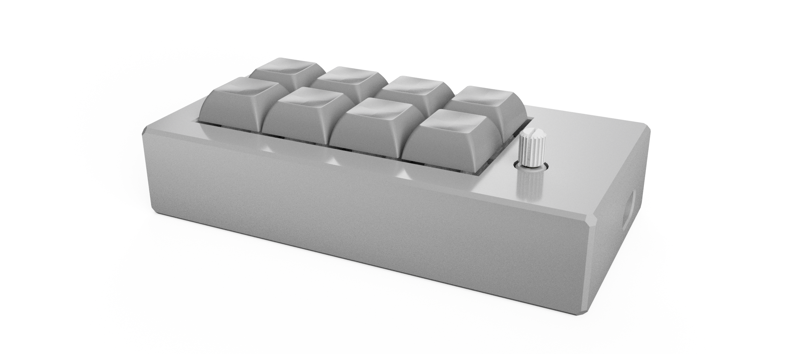
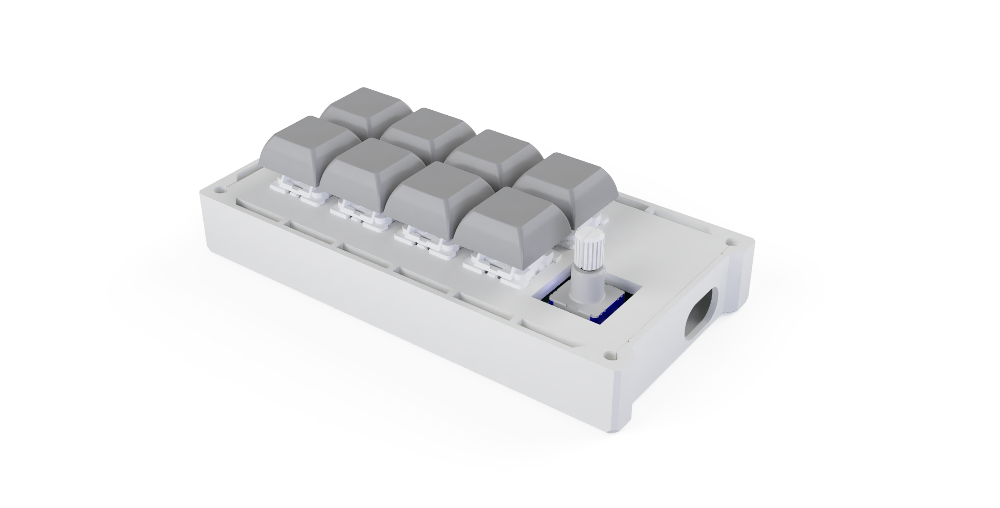
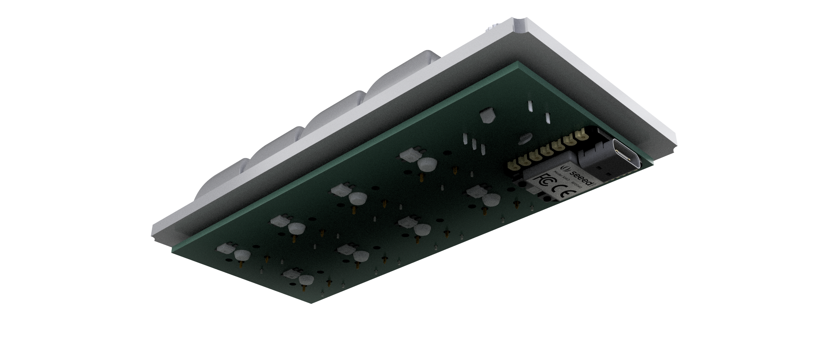
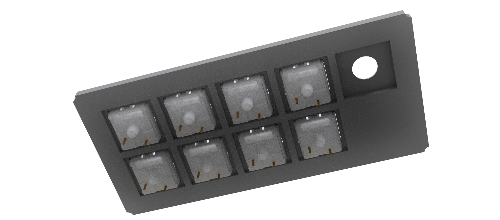
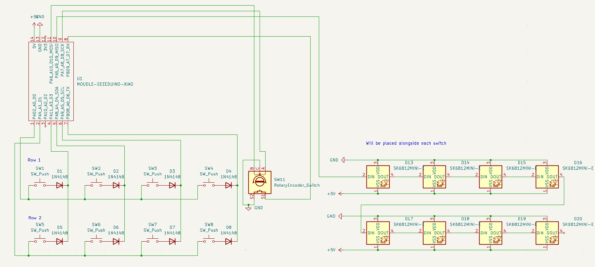
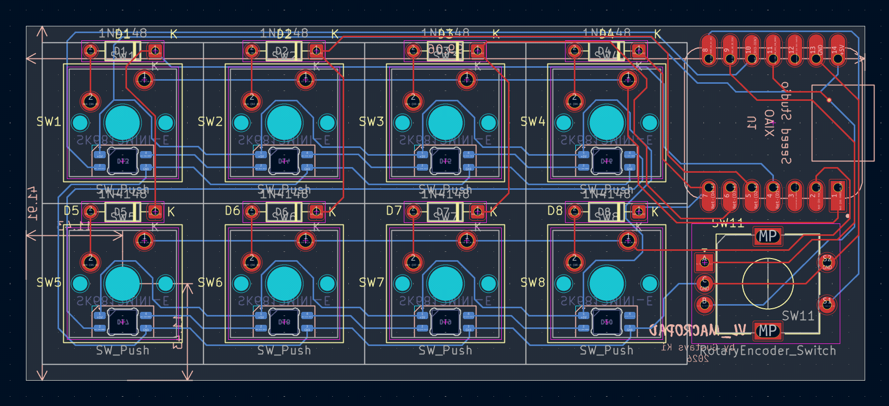
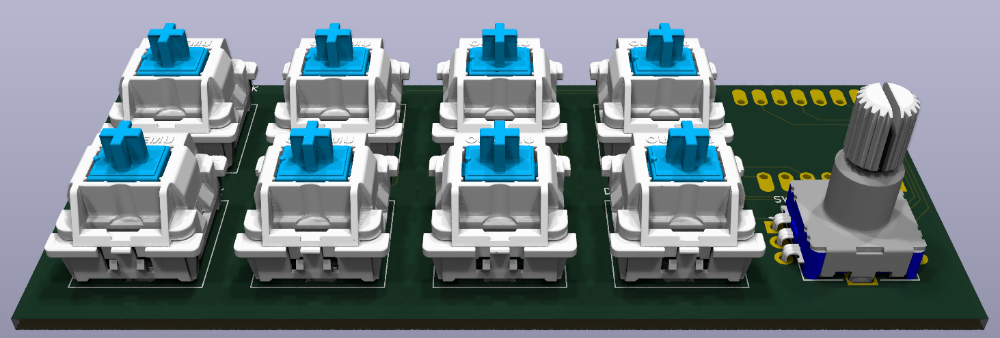
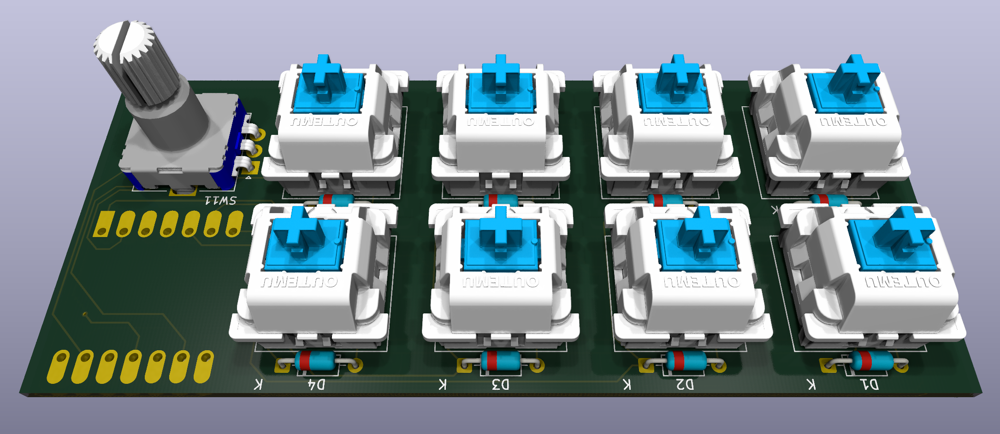

This is my first hardware project I've ever did! I've made a lot of mistakes making it this far; I lost the count on  how many times I redesigned both the PCB and the case being sure it would be the last time.

On the PCB I'd maybe just put the mcu on the other side (again). Other than that, there doesn't seems to be much else to be improve on the PCB, though some silly art on the silkscreen could be added.

# vl_macropad

vl_macropad is an 8 key macropad with a rotary encoder, using QMK firmware. The mcu used is the Xiao RP2040

# Features

 - 8 mechanical MX-style switches(soldered)
 - An EC11 rotary encoder
 - 8 SK6812MINI-E LEDs for backlight(I hope)

# CAD Model

The structure of this macropad is heavily inspired* by the sandwich-style structure of mechanical keyboards. 

There are no heatset inserts used in this design to keep the profile a little bit smaller(though it could be smaller imo). It's (supposed to be) held together by 4 16mm M3 screws that are exactly about 16mm long because otherwise the top part will break or not be held down properly.

> Some 3d renders I got a bit carried away making
> 
>

# PCB

The PCB which is a 2-layer one I made in kicad. This is the result after a couple of iterations.

> Schematic
>
> 

> PCB
>
> 
> 
> 

The pcb is 99.06mm x 41.91mm in size.

# Firmware

The firmware in use is QMK.

At the moment I have no idea whether the firmware works at all

# Layout

## Base layer(BL)

the *default* behaviour

Encoder CW/CCW - volume up/down; press - mute

|  |  |  |  |  |
|---|---|---|---|---|
| F13 | F14 | media  previous | media next |  |
| F15 | F16 | F17 | media play/pause | audio mute/unmute |

# BOM

| Item | Qty |
|---|---|
| 1N4148 diode | 8 |
| SK6812MINI-E LED | 8 |
| MX-style switch | 8 |
| DSA keycap | 8 |
| EC11 Rotary encoder | 1 |
| XIAO RP2040 | 1 |
| M3x16mm screw | 4 |
| Case (3 printed parts) | 1 |
| PCB | 1 |

# Does it work??

I did try to make it according to the design. The first trouble was the LEDs. The LED's on the firt board I assembled just seemed to have shorted out and drew just about as much current as could. I couldn't get as much as a single led working. Therefore I ommited the LEDs from the next boards I assembled. After making modifications to the firmware, **it did work**, however after a couple of days it started booting into the bootloader mode. Given it worked before, it's probably just a skill issue of mine.
